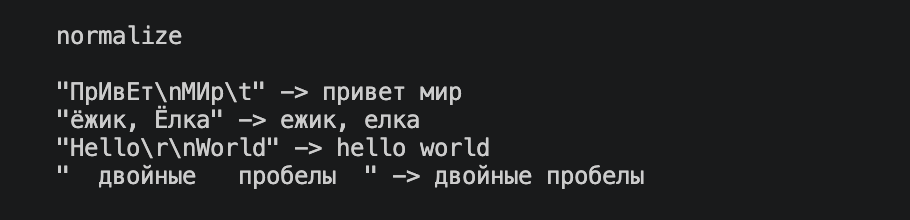
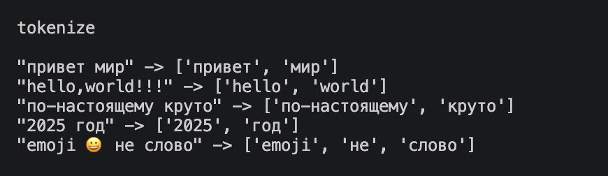
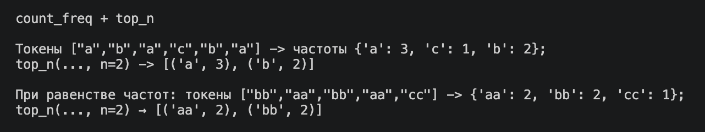
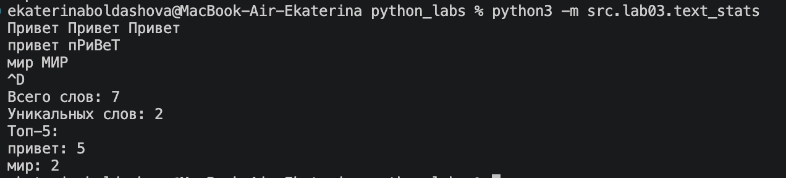
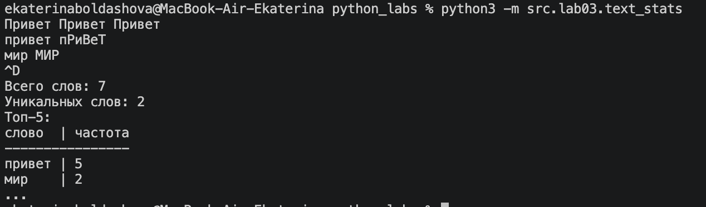

# Отчет по лабораторной работе №3 — Тексты и частоты слов

## Задание A — Библиотечный модуль `src/lib/text.py`

Реализован переиспользуемый модуль `src/lib/text.py`, содержащий чистые функции для нормализации текста, токенизации, подсчета частоты слов и формирования топа слов.

### 1. Функция `normalize`
Преобразует строку: приведение к нижнему регистру (`casefold`), замена `ё/Ё` на `е/Е` и удаление управляющих символов и лишних пробелов.

```python
def normalize(text: str, *, casefold: bool = True, yo2e : bool = True) -> str:
    r'''нормализует строку:
        если casefold = True, приводит к сложенному регистру, иначе - к нижнему
        если yo2e = True, заменяет ё на е,
        убирает невидимые управляющие символы и линие пробелы
        
        normalize("ПрИвЕт\nМИр\t") → "привет мир"
    '''
    
    if casefold:
        text = text.casefold()
    else:
        text = text.lower()
    if yo2e:
        text = text.replace('ё', 'е')
    text = ' '.join(text.split())
    return text
```


*Рис. 1. Результат работы и тестов функции normalize*

---

### 2. Функция `tokenize`

Разбивает текст на слова (буквы, цифры, знак подчеркивания) по разделителям, сохраняя дефисы внутри слов.

```python
import re


def tokenize(text:str) -> list[str]:
    '''разбивает на «слова» по небуквенно-цифровым разделителям.'''
    
    return re.findall(r"\w+(?:-\w+)*", text)

```



*Рис. 2. Результат работы и тестов функции tokenize*

---

### 3. Функции `count_freq` и `top_n`

`count_freq` подсчитывает частоту встречаемости токенов за линейное время $O(N)$. `top_n` возвращает первые $N$ частых слов с алфавитной сортировкой при равенстве частот.

```python
def count_freq(tokens: list[str]) -> dict[str,int]:
    '''считает частоты в словарь {слово: количество}'''
    
    count_fr = {}
    for i in set(tokens):
        count_fr[i] = tokens.count(i)
    return count_fr


def top_n(freq: dict[str, int], n: int = 5) -> list[tuple[str, int]]:
    '''Выводит тоx n слов по частоте обращения '''

    return sorted(freq.items(), key = lambda x: (-x[1],x[0]))[:n]

```



*Рис. 3. Результат работы и тестов функций count_freq и top_n*

---

## Задание B — Скрипт статистики `src/lab03/text_stats.py`

Скрипт читает вход из `stdin`, вызывает функции из `src/lib/text.py` и печатает базовую статистику текста.

### Исходный код `src/lab03/text_stats.py`

```python
from src.lib.text import normalize, tokenize, count_freq, top_n
import sys 

text = sys.stdin.read()
if text.strip() == '':
    raise ValueError('Не был введен текст')

if_beautiful = 1  # Переменная, определяющая красивый (табличный) вывод


normal_text = normalize(text)
tokens = tokenize(normal_text)
words_cnt = count_freq(tokens)
top_words = top_n(words_cnt)


print(f'''
Всего слов: {len(tokens)}
Уникальных слов: {len(words_cnt)}
Топ-5:''')

if not if_beautiful: 
    for val in top_words:
        print(f'{val[0]}:{val[1]}')
        
else: 
    max_len = max([len(val[0]) for val in top_words] + [len('слово')])
    head = f'{"слово":<{max_len}} | частота'

    print(head)
    print('-' * len(head))
    for top in top_words:
        print(f'{top[0]:<{max_len}} | {top[1]}')
    print('...')

```

### Примеры работы скрипта

#### 1. Обычный режим вывода



*Рис. 4. Результат запуска скрипта в обычном режиме*

#### 2. Табличный (красивый) режим вывода



*Рис. 5. Результат запуска скрипта в красивом табличном режиме*