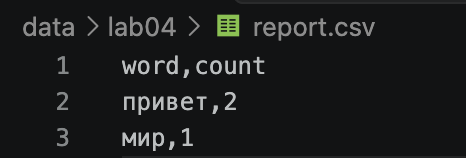
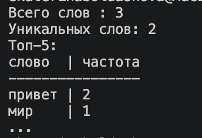
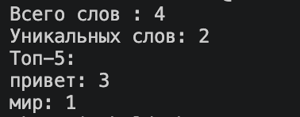
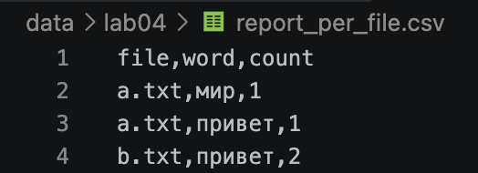
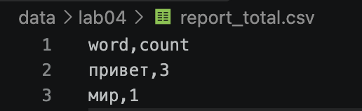

# Отчет по лабораторной работе №4 — Файлы: TXT/CSV и отчеты по текстовой статистике

## Задание A — модуль ввода/вывода `src/lab04/io_txt_csv.py`

Реализован модуль для чтения текстовых файлов и записи результатов в CSV. Для работы с путями используется `Path`, а для формирования CSV — стандартный модуль `csv`.

### 1. Функция `read_text`

Функция читает файл целиком и возвращает его содержимое в виде одной строки. По умолчанию используется кодировка UTF-8, но при необходимости можно передать другую кодировку, например `encoding="cp1251"`.

```python
from pathlib import Path
import csv
import sys

def read_text(path: str | Path, encoding: str = "utf-8") -> str:
    '''Считывает текст по указанному пути

    Args:
        path: Путь к файлу в формате строки или Path
        encoding: Тип кодировки файла (пример: encoding ="cp1251"), по умолчанию utf-8

    Returns:
        Содержимое файла в виде строки
    '''
    
    try:
        with open(path, "r", encoding=encoding) as f:
            text = f.read()
            return text
    except FileNotFoundError:
        print(f"файл не найден: {path}", file=sys.stderr)
        sys.exit(1)
    except UnicodeDecodeError:
        print(f"кодировка не подходит: {path}", file=sys.stderr)
        sys.exit(1)
```

Если файл не найден, возникает `FileNotFoundError`. При несовпадении кодировки возникает `UnicodeDecodeError`.

### 2. Функция `write_csv`

Функция записывает строки в CSV-файл. Перед записью проверяется, что все строки имеют одинаковую длину. Если длины отличаются, вызывается `ValueError`, cоздaет родительские директории, если их нет.

```python
def write_csv(rows: Iterable[Sequence], path: str | Path,
              header: tuple[str, ...] | None = None) -> None:
    '''Записывает частоты слов в csv файл
        Args:
            rows: Итерируемый объект строк, которые нужно внести в файл
            path: Путь к файлу записи
            header: Заголовок файла
    
        Returns:
            None
    
        Raises:
            ValueError: Строки разной длинны
    '''
    
    rows = list(rows)
    if rows:
        etalon = len(rows[0])
        for r in rows:
            if len(r) != etalon:
                raise ValueError('Строки разной длинны')
    ensure_parent_dir(path)
    with open(path, 'w', newline="", encoding="utf-8") as f:
        w = csv.writer(f)
        if header is not None:
            w.writerow(header)
        for r in rows:
            w.writerow(r)
```

Если передан параметр `header`, он записывается первой строкой файла.

### 3. Функция `ensure_parent_dir`

Функция проверяет наличие родительской папки и создает ее вместе со всеми отсутствующими вложенными папками.

```python
def ensure_parent_dir(path: str | Path) -> None:
    '''Проверяет наличие родительских папок, если их нет, то создает их
    Args:
        path: Путь к файлу в формате строки или Path

    Returns:
        None
    '''
    
    Path(path).parent.mkdir(parents=True, exist_ok=True)     
```


## Задание B — скрипт статистики `src/lab04/text_report.py`

Скрипт читает текстовые файлы, использует функции `normalize`, `tokenize`, `count_freq` и `top_n` из лабораторной работы №3, а затем сохраняет частоты слов в CSV-файлы.

### Исходный код `src/lab04/text_report.py`

```python
from src.lab04.io_text_csv import read_text, write_csv
from src.lib.text import normalize,tokenize,count_freq,top_n
import argparse


parser = argparse.ArgumentParser()
parser.add_argument("--in", nargs="+", help="Список файлов для обработки", dest= "input_files", default=  ["data/lab04/input.txt"])
parser.add_argument("--out", help="файл для вывода", dest = "output_file", default="data/lab04/report.csv")
parser.add_argument("--encoding", help="кодировка",default="utf8")
parser.add_argument('--per-file', default='data/lab04/report_per_file.csv', dest = "per_file")
parser.add_argument('--total', default='data/lab04/report_total.csv')
args = parser.parse_args()


flag = len(args.input_files)>1
per_sorted_freqs = []
all_sorted_freqs = {}
for file in sorted(args.input_files):
    text = read_text(file,encoding=args.encoding)

    normal_text = normalize(text)
    tokens = tokenize(normal_text)
    freqs = count_freq(tokens)
    sorted_freqs = top_n(freqs,len(freqs))
    
    if flag:
        just_file = file[file.rfind("/")+1:]
        for x in sorted_freqs:
            per_sorted_freqs.append((just_file, x[0],x[1]))
            all_sorted_freqs[x[0]] = all_sorted_freqs.get(x[0], 0) + x[1]
if flag:
    per_sorted_freqs = sorted(per_sorted_freqs, key = lambda x: (x[0],-x[2],x[1]))
    all_sorted_freqs = top_n(all_sorted_freqs,len(all_sorted_freqs))
    
    write_csv(per_sorted_freqs, args.per_file, ("file","word","count"))
    write_csv(all_sorted_freqs, args.total, ("word","count"))
    print(f'Всего слов : {sum([i[1] for i in all_sorted_freqs])}\nУникальных слов: {len(all_sorted_freqs)}\nТоп-5:')
    for val in all_sorted_freqs[:5]:
        print(f'{val[0]}: {val[1]}')
else:
    write_csv(sorted_freqs, args.output_file, ("word","count"))
    print(f'Всего слов : {sum([i[1] for i in sorted_freqs])}\nУникальных слов: {len(sorted_freqs)}\nТоп-5:')
    for val in sorted_freqs[:5]:
        print(f'{val[0]}: {val[1]}')
    
```

Скрипт поддерживает следующие параметры:

- `--in` — один или несколько входных файлов. Если параметр не указан, используется
  `data/lab04/input.txt`;
- `--out` — путь к отчету для режима одного файла;
- `--encoding` — кодировка входных файлов, по умолчанию `utf-8`;
- `--per-file` — путь к отчету по отдельным файлам в режиме нескольких файлов;
- `--total` — путь к сводному отчету в режиме нескольких файлов.

### Пример запуска для одного файла

```bash
python3 -m src.lab04.text_report
```

В этом режиме читается `data/lab04/input.txt`, а результат записывается в `data/lab04/report.csv`.



*Рис. 1. Результат записи данных в CSV-файл.*



*Рис. 2. Результат запуска скрипта для одного входного файла.*

### Пример запуска для нескольких файлов

```bash
python3 -m src.lab04.text_report --in data/lab04/a.txt data/lab04/b.txt
```

В этом режиме отдельно создаются `report_per_file.csv` и `report_total.csv`.
В консоли выводятся общее количество слов, число уникальных слов и пять самых
частотных слов. Для пустого набора слов скрипт также выполняется без ошибки.




*Рис. 3. Результат запуска скрипта для нескольких входных файлов.*

### Отчет по каждому файлу



*Рис. 4. Содержимое отчета `report_per_file.csv`.*

### Сводный отчет



*Рис. 5. Содержимое сводного отчета `report_total.csv`.*