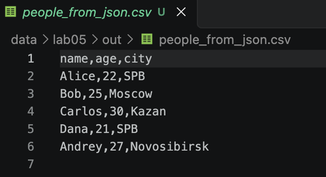
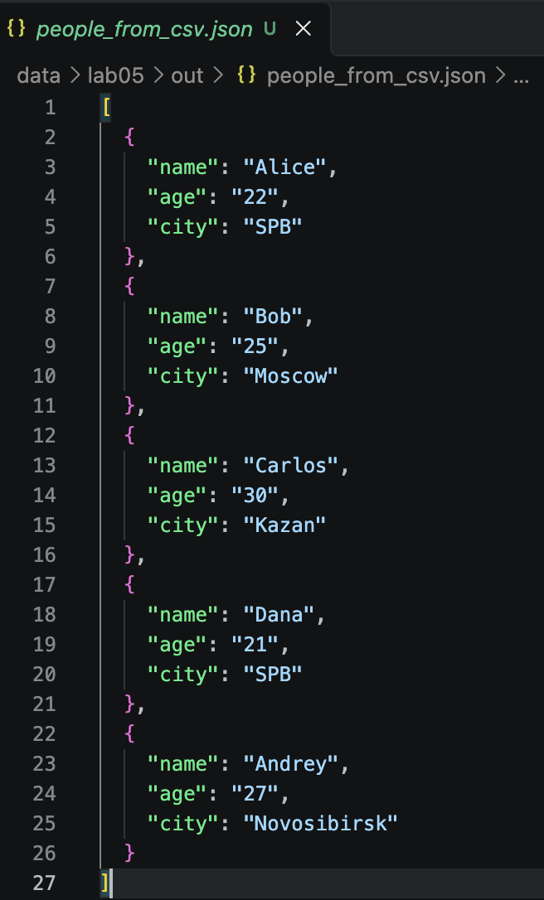
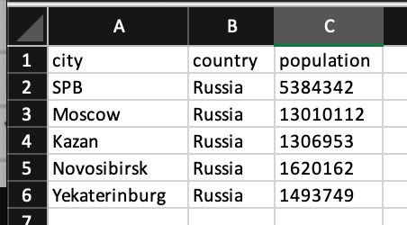
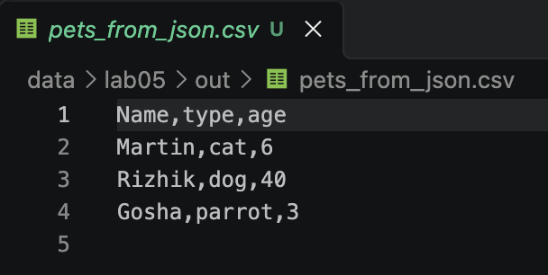
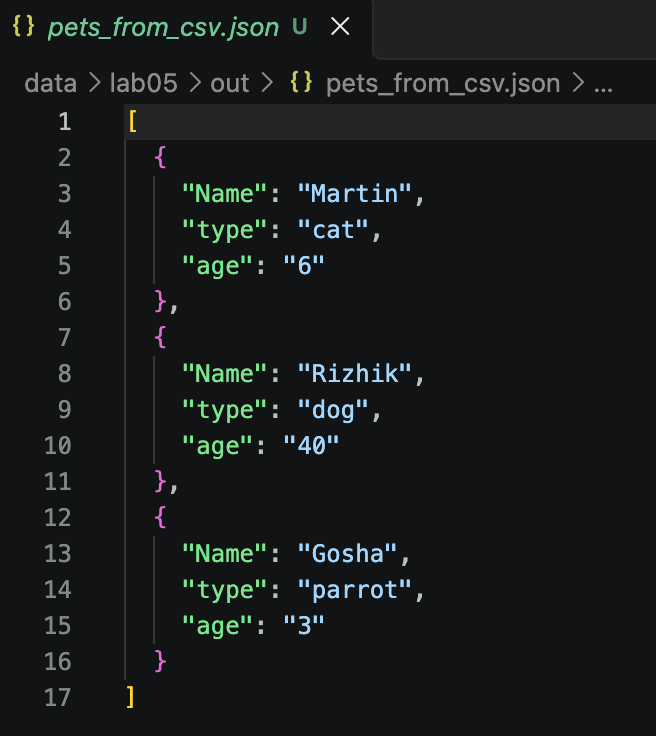
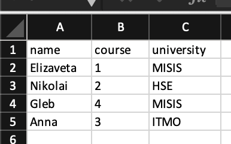

# Отчет по лабораторной работе №5 — JSON, CSV и XLSX

## Структура лабораторной работы

- `src/lab05/json_csv.py` — преобразование JSON в CSV и CSV в JSON;
- `src/lab05/csv_xlsx.py` — преобразование CSV в XLSX.

Входные примеры находятся в каталоге `data/lab05/samples/`, а результаты
конвертаций — в каталоге `data/lab05/out/`.

## Задание A — JSON ↔ CSV

Модуль [json_csv.py](./json_csv.py) содержит две функции.

### Функция `json_to_csv`

```python
def json_to_csv(json_path: str, csv_path: str) -> None:
    '''Записывает значения

    Args:
        json_path: Путь к json файлу из которого читаем
        csv_path: Путь к csv файлу куда пишем

    Returns: 
        None

    Raises:
        FileNotFoundError: 
            Указанный JSON файл не найден
        ValueError:
            Указанный файл не формата JSON
            Пустой JSON или неподдерживаемая структура
            Файл JSON пустой или имеет неправильный формат
            Все элементы списка JSON должны быть словарями
    '''
    j_p = Path(json_path)
    c_p = Path(csv_path)
    
    if not j_p.exists():
        raise FileNotFoundError(f"файл не найден: {j_p}")
    if j_p.suffix.lower() != '.json':
        raise ValueError(f"Указанный файл не формата JSON: {j_p}")
    

    with j_p.open('r', encoding='utf-8') as j_f:
        try:
            data = json.load(j_f)
        except json.JSONDecodeError as e:
            raise ValueError(f"Файл содержит некорректный JSON: {e.lineno}, {e.msg}")
        if not isinstance(data,list) or len(data) == 0:
            raise ValueError("Файл JSON пустой или имеет неправильный формат")
        if not all(isinstance(x, dict) for x in data):
            raise ValueError("Все элементы списка JSON должны быть словарями")
        
    ensure_parent_dir(c_p)
    # порядок колонок определяется их первым появлением в JSON
    headers = []
    seen = set()
    for item in data:
        for key in item.keys():
            if key not in seen:
                seen.add(key)
                headers.append(key)
            
    with open(c_p, 'w', newline="", encoding="utf-8") as c_f:
            #restval - заполняет отсутствующие поля пустыми строками
            writer = csv.DictWriter(c_f, fieldnames=headers, restval="")
            writer.writeheader()
            writer.writerows(data)
```

Функция:

1. проверяет существование входного файла;
2. проверяет расширение `.json`;
3. читает JSON в кодировке UTF-8;
4. проверяет, что корневой объект является непустым списком словарей;
5. собирает названия всех ключей в порядке их первого появления;
6. записывает заголовок и строки в CSV в кодировке UTF-8.

Если в одном из словарей отсутствует ключ, `csv.DictWriter` записывает в
соответствующую ячейку пустое значение.

Пример вызова:

```python
json_to_csv(
    "data/lab05/samples/people.json",
    "data/lab05/out/people_from_json.csv",
)
```

Результат:


### Функция `csv_to_json`

```python
def csv_to_json(csv_path: str, json_path: str) -> None:
    '''Записывает значения

    Args:
        csv_path: Путь к csv файлу из которого читаем
        json_path: Путь к json файлу куда пишем
        
    Returns: 
        None

    Raises:
        FileNotFoundError: 
            Указанный CSV файл не найден
        ValueError:
            Указанный файл не формата CSV
            CSV файл пустой
    '''
    
    j_p = Path(json_path)
    c_p = Path(csv_path)
    
    if not c_p.exists():
        raise FileNotFoundError(f"Указанный CSV файл не найден: {c_p}")
    
    if c_p.suffix.lower() != '.csv':
        raise ValueError(f"Указанный файл не формата CSV: {c_p}")
    

    with open(c_p, 'r', encoding='utf-8') as c_f:
        reader = csv.DictReader(c_f)
        if reader.fieldnames is None:
            raise ValueError("CSV файл пустой")
        data = list(reader)
    
    if not data:
        raise ValueError("Файл CSV не содержит данных")
        
    ensure_parent_dir(j_p)
            
    with j_p.open('w', encoding="utf-8") as j_f:
        json.dump(data, j_f, ensure_ascii=False, indent=2)
```

Функция:

1. проверяет существование входного файла;
2. проверяет расширение `.csv`;
3. читает CSV в кодировке UTF-8;
4. проверяет наличие заголовка и хотя бы одной строки данных;
5. преобразует каждую строку в словарь;
6. сохраняет список словарей в JSON с отступом в два пробела.

Пример вызова:

```python
csv_to_json(
    "data/lab05/samples/people.csv",
    "data/lab05/out/people_from_csv.json",
)
```
Результат:


## Задание B — CSV → XLSX

Модуль [csv_xlsx.py](./csv_xlsx.py) содержит функцию:

```python
def csv_to_xlsx(csv_path: str, xlsx_path: str) -> None:
    '''
    Конвертирует CSV в XLSX.
    
    Args:
        csv_path: Путь к csv файлу из которого читаем
        xlsx_path: Путь к xlsx файлу куда пишем
        
    Returns: 
        None

    Raises:
        FileNotFoundError: 
            Указанный CSV файл не найден
        ValueError:
            Указанный файл не формата CSV
            CSV файл пустой
    '''
    c_p = Path(csv_path)
    x_p = Path(xlsx_path)
    
    if not c_p.exists():
        raise FileNotFoundError(f"Указанный CSV файл не найден: {c_p}")
    
    if c_p.suffix.lower() != '.csv':
        raise ValueError(f"Указанный файл не формата CSV: {c_p}")
    
    wb = Workbook()
    ws = wb.active
    if ws is None:
        ws = wb.create_sheet("Sheet1")
    ws.title = "Sheet1"

    with open(c_p, encoding="utf-8") as c_f:
        for row in list(csv.reader(c_f)):
            ws.append(row) 
            
    for col in ws.columns:
        max_len = 0
        letter = col[0].column_letter

        for cell in col:
            if cell.value and len(str(cell.value)) > max_len:
                max_len = len(str(cell.value))

        ws.column_dimensions[letter].width = max(max_len, 8)

    ensure_parent_dir(x_p)      
    wb.save(x_p)
```

Функция:

1. проверяет существование CSV-файла;
2. проверяет расширение `.csv`;
3. читает строки в кодировке UTF-8;
4. создаёт книгу Excel с помощью `openpyxl`;
5. добавляет строки CSV на лист `Sheet1`;
6. рассчитывает ширину столбцов;
7. сохраняет результат по указанному пути.

Ширина столбца вычисляется по самому длинному текстовому значению в столбце:

```python
ws.column_dimensions[letter].width = max(max_len, 8)
```

Пример вызова:

```python
csv_to_xlsx(
    "data/lab05/samples/cities.csv",
    "data/lab05/out/cities.xlsx",
)
```
Результат:


## Примеры данных и результаты

Для демонстрации используются следующие файлы:

- `data/lab05/samples/pets.json` — список питомцев в формате JSON;
- `data/lab05/samples/pets.csv` — те же данные в формате CSV;
- `data/lab05/samples/students.csv` — дополнительный CSV со студентами;
- `data/lab05/out/pets_from_json.csv` — результат JSON → CSV;
- `data/lab05/out/pets_from_csv.json` — результат CSV → JSON;
- `data/lab05/out/students.xlsx` — результат CSV → XLSX.

## Проверка результатов

### 1. JSON → CSV



*Рис. 1. Результат преобразования JSON в CSV.*

### 2. CSV → JSON



*Рис. 2. Результат преобразования CSV в JSON.*

### 3. CSV → XLSX



*Рис. 3. Результат преобразования CSV в XLSX.*