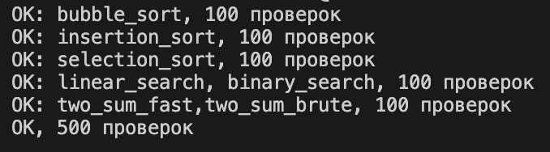
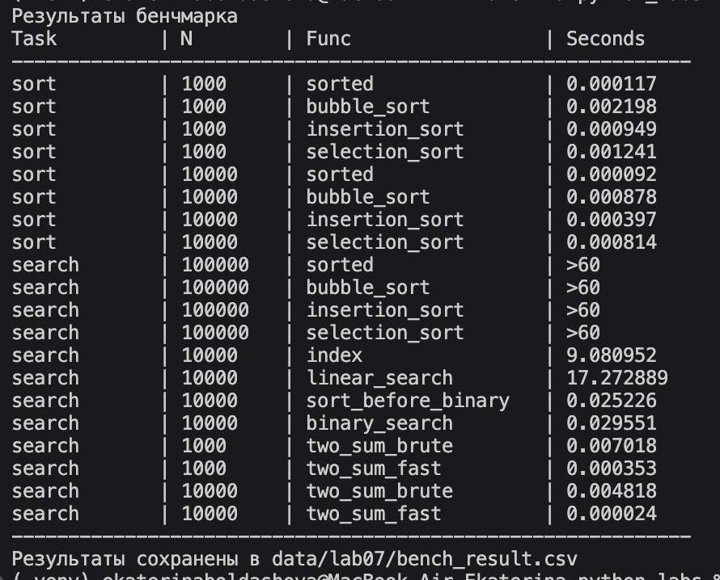

# Лабораторная работа №7

---

## Задание A. Поиск (search.py)

### linear_search

Последовательно перебирает элементы списка и сравнивает их с искомым числом. Возвращает индекс первого вхождения или -1, если число не найдено. 

*Сложность: O(n)*

```Python
def linear_search(nums, x) -> int:
    """Возвращает индекс первого вхождения x или -1."""
    for i in range(len(nums)):
        if nums[i] == x:
            return i
    return -1
```

### binary_search

Ищет число в отсортированном списке, каждый раз уменьшая область поиска вдвое. Возвращает индекс найденного элемента или -1. 

*Сложность: O(log n)*

```Python
def binary_search(sorted_nums, x) -> int:
    """Ищет x  в отсортированном списке.
    Для неотсортированного списка результат не определен."""
    lo=0
    hi=len(sorted_nums)-1
    while lo<=hi:
        mid = (lo+hi)//2
        if x < sorted_nums[mid]:
            hi = mid -1
        elif x > sorted_nums[mid]:
            lo = mid+1
        else: 
            while mid > 0 and sorted_nums[mid]==sorted_nums[mid-1]:
                mid -= 1
            return mid
    return -1
```

### two_sum_brute

С помощью двух вложенных циклов перебирает пары чисел и ищет пару с заданной суммой. Возвращает индексы в кортеже или None. 

*Сложность: O(n^2)*

```Python
def two_sum_brute(nums, target):
    """Ищет пару индексов таких чисел, сумма которых равна target."""
    for i in range(len(nums)):
        for j in range(i+1, len(nums)):
            if nums[i]+nums[j]==target:
                return (i,j)
    return None
```

### two_sum_fast

Ищет пару чисел с нужной суммой за один проход. Использует словарь для хранения просмотренных чисел и их индексов.

*Сложность: O(n)*

```Python
def two_sum_fast(nums, target):
    seen = {}
    for i,x in enumerate(nums):
        if target-x in seen:
            return (seen[target-x],i)
        else:
            seen[x] = seen.get(x,0) or i
    return None
```

---
## Задание B. Сортировки (sorting.py)

### bubble_sort

Сравнивает соседние элементы и меняет их местами, если они стоят в неправильном порядке. Повторяет проходы до завершения сортировки.

*Сложность: O(n^2) в худшем случае, O(n) для уже отсортированного списка с ранним выходом*

```Python
def bubble_sort(nums) -> list:
    """Новый список, отсортированный по возрастанию пузырьком. Исходный не меняется."""
    nums = list(nums)
    n = len(nums)
    for i in range(n-1):
        flag=True
        for j in range(n-i-1):
            if nums[j]>nums[j+1]:
                nums[j],nums[j+1]=nums[j+1],nums[j]
                flag=False
        if flag:
            break
    return nums
```
### insertion_sort

Последовательно берет элементы списка и вставляет каждый на нужное место среди уже отсортированных элементов.

*Сложность: O(n^2), O(n) для уже отсортированного*
```Python
def insertion_sort(nums) -> list:
    """Новый список, отсортированный по возрастанию вставками. Исходный не меняется."""
    nums = list(nums)
    for i in range(1,len(nums)):
        key = nums[i]
        j=i-1
        while j>=0 and nums[j]>key:
            nums[j+1]=nums[j]
            j-=1
        nums[j+1]=key
    return nums
```

### selection_sort

На каждом проходе находит минимальный элемент в неотсортированной части списка и меняет его местами с текущим.

*Сложность: O(n^2), так как поиск минимального элемента повторяется для каждой позиции*

```Python
def selection_sort(nums) -> list:
    """Новый список, отсортированный по возрастанию выбором. Исходный не меняется."""
    nums = list(nums)
    for i in range(len(nums)):
        m=i
        for j in range(i+1,len(nums)):
            if nums[j]<nums[m]:
                m = j
        nums[i],nums[m] = nums[m],nums[i]
    return nums
```
---
## Задание C. Проверка против эталона (check.py)

### Импортируемые функции и библиотеки

* random - библиотека, чтобы генерировать случайные числа. Используется в создании рандомных списков и чисел для проверки.
* src.lab04.io_text_csv - функция write_csv была использована для создания файлов для bench
* src.lab_07.sorting (...) - функции сортировок.
* src.lab_07.search (...) - функции поиска.

```Python
import random
#from src.lab04.io_text_csv import write_csv
from src.lab07.sorting import bubble_sort,insertion_sort,selection_sort
from src.lab07.search import linear_search, binary_search, two_sum_brute, two_sum_fast
```

### check_sorting

Проверяет сортировки на случайных списках, сравнивает результат с sorted() и проверяет сохранность исходного списка. При расхождении поднимается AssertionError с данными, на которых оно случилось.

```Python
def check_sorting(fn, trials=100):
    all = []
    for _ in range(trials):
        n = random.randint(0, 50)
        nums = [random.randint(-100, 100) for _ in range(n)]
        original = list(nums)
        result = fn(nums)
        assert result == sorted(nums), f"{fn.__name__} ошиблась на {nums}: {result}"
        assert nums == original, f"{fn.__name__} изменила исходный список"
    # создание файлов для bench
    #     all.append(nums)
    # write_csv(all,"data/samples/lab07/numbers2sort_{n}.csv")
    print(f"OK: {fn.__name__}, {trials} проверок")
    return trials
```

### check_search

Проверяет линейный и бинарный поиск на случайных списках, сравнивая результаты с ожидаемыми. При расхождении поднимается AssertionError с данными, на которых оно случилось.

```Python
def check_search(trials=100):
    for _ in range((trials+1)//2):
        # поиск любого существующего числа
        n = random.randint(1, 50)
        nums = [random.randint(-100, 100) for _ in range(n)]
        need = random.choice(nums)
        assert linear_search(nums,need) == nums.index(need), (f"linear_search: {need} in {nums}")
        nums.sort()
        assert binary_search(nums, need) == nums.index(need), (f"binary_search: {need} in {nums}")   
             
        
    for _ in range((trials//2+1)//2):
        # поиск несуществующего числа
        n = random.randint(0, 50)
        nums = [random.randint(-100, 100) for _ in range(n)]
        need = random.choice((random.randint(-200,-100),random.randint(100,200)))
        assert linear_search(nums, need) == -1, (f"linear_search: {need} in {nums}")
        nums.sort()
        assert binary_search(nums, need) == -1, (f"binary_search: {need} in {nums}")             
        
    for _ in range(trials//4):
        # поиск числа на границе
        n = random.randint(1, 50)
        nums = [random.randint(-100, 100) for _ in range(n)]
        need = nums[random.choice((0,-1))]
        assert linear_search(nums, need) == nums.index(need), (f"linear_search: {need} in {nums}")
        nums.sort()
        assert binary_search(nums, need) == nums.index(need), (f"binary_search: {need} in {nums}")        
    
    print(f"OK: linear_search, binary_search, {trials} проверок")
    return trials
```

### check_two_sum

Проверяет оба алгоритма поиска пары чисел и правильность полученных результатов. При расхождении поднимается AssertionError с данными, на которых оно случилось.

```Python
def check_two_sum(trials=100):
    for _ in range((trials+1)//2):
        n = random.randint(2, 50)
        nums = [random.randint(-100, 100) for _ in range(n)]
        a,b = random.sample(nums,2)
        i,j = two_sum_fast(nums,a+b)
        assert nums[i]+nums[j] == a+b, (f"two_sum_fast: {a}+{b}={a+b} in {nums}") 
        i,j = two_sum_brute(nums,a+b)
        assert nums[i]+nums[j] == a+b, (f"two_sum_brute: {a}+{b}={a+b} in {nums}")
        
    for _ in range(trials//2):
        n = random.randint(0, 50)
        nums = [random.randint(-100, 100) for _ in range(n)]
        a = random.randint(100,200)
        b = random.randint(100,200)
        assert two_sum_fast(nums,a+b) == None, (f"two_sum_fast: {a}+{b}={a+b} in {nums}") 
        assert two_sum_brute(nums,a+b) == None, (f"two_sum_brute: {a}+{b}={a+b} in {nums}")
         
    print(f"OK: two_sum_fast,two_sum_brute, {trials} проверок")
    return trials
```

### main

Релизован подсчет общего числа проверок + выводится подтверждение, что все n проверок пройдены.

```Python
if __name__== "__main__":
    random.seed(42)
    n=0
    
    for fn in (bubble_sort, insertion_sort, selection_sort):
        n+=check_sorting(fn)
    
    n+=check_search()
    
    n+=check_two_sum()
    
    print(f"OK, {n} проверок")
```
*Как запустить?*

```python3 -m src.lab07.check```

*Что выводит?*



---
## Задание D. Бенчмарк (bench.py)

### Импортируемые функции и библиотеки

* CSV - необходимая библиотека для оформления вывода бенчмарка. 
* src.lab04.io_text_csv - функция write_csv , чтобы оформить данные в csv файл.
* timeit - библиотека, чтобы замерить время выполнения сортировок и поиска.
* random - библиотека, чтобы генерировать случайные числа. Используется в создании рандомных списков и чисел для проверки.
* src.lab_07.sorting (...) - функции сортировок.
* src.lab_07.search (...) - функции поиска элемента.

```Python
import csv
import timeit
import random
from src.lab04.io_text_csv import write_csv
from src.lab07.sorting import *
from src.lab07.search import *
```

### bench_sorts

Создает случайные списки разных размеров и измеряет время сортировок с помощью timeit. Результат сохраняется в списке с кортежами данных.

```Python
def bench_sorts(n):
    """Запускает бенчмарки для сортировок и собирает данные в список с кортежами"""
    data = read_numbers(f"data/samples/lab07/numbers2sort_{n}.csv")
    rows = []
    for fn in (sorted, bubble_sort,insertion_sort,selection_sort):
        if n <100_000:
            t = timeit.timeit(lambda: fn(data), number=1)
            rows.append(("sort", n, fn.__name__, f"{t:.6f}"))
        else:
            rows.append(("search", 10_000, fn.__name__, ">60"))
    return rows
```

### bench_search

Измеряет время линейного, бинарного поиска и двух вариантов two_sum с помощью timeit. Полученные данные записываются в кортежи, а потом объединяются в список.

```Python
def bench_search():
    """Запускает бенчмарки для поиска и собирает данные в список с кортежами"""
    targets=[]
    data = [random.randint(-100_000, 100_000) for i in range(100_000)]
    targets = [random.choice(data) for _ in range(10_000)]
    
    
    rows=[]

    t = timeit.timeit(lambda: [data.index(t) for t in targets], number=1)
    rows.append(("search", 10_000, "index", f"{t:.6f}"))
    

    time_ls = timeit.timeit(lambda: [linear_search(data,t) for t in targets],  number =1)
    rows.append(("search", 10_000, "linear_search", f"{time_ls:.6f}"))

    time_sbb=timeit.timeit(lambda: sorted(data), number=1)
    rows.append(("search", 10_000, "sort_before_binary", f"{time_sbb:.6f}"))
    sorted_data= sorted(data)

    time_bs = timeit.timeit(lambda: [binary_search(sorted_data,t) for t in targets],  number =1)
    rows.append(("search", 10_000, "binary_search", f"{time_bs:.6f}"))

    for n in [1_000,10_000]:
        data_ts = [random.randint(-1_000_000,1_000_000) for _ in range(n)]
        a, b = random.sample(data_ts, 2)
        target = a+b

        time_tsb = timeit.timeit(lambda: two_sum_brute(data_ts,target), number=1)
        rows.append(("search", n, "two_sum_brute", f"{time_tsb:.6f}"))

        time_tsf = timeit.timeit(lambda: two_sum_fast(data_ts,target), number=1)
        rows.append(("search", n, "two_sum_fast", f"{time_tsf:.6f}"))

    return rows
```

### main

Объединяет все полученные данные из предыдущих функций в общий csv файл и выводит эти же данные в виде таблицы в терминал. 

```Python
def main():
    header = ("task", "n", "func", "seconds")
    rows=[]
    for i in (1_000,10_000):
        rows.extend(bench_sorts(i))
    rows.extend(bench_search())

    write_csv(rows, 'data/out/lab07/bench_result.csv', header)

    print("Результаты бенчмарка")
    print(f"{'Task':<12} | {'N':<8} | {'Func':<20} | {'Seconds':<12}")
    print('-'*60)
    for t, n, f, s in rows:
        print(f"{t:<12} | {n:<8} | {f:<20} | {s:<12}")
    print('-'*60)
    print("Результаты сохранены в data/lab07/bench_result.csv")


if __name__ == "__main__":
    main()
```

*Как запустить?*

```python3 -m src.lab07.bench```

*Что выводит?*

* *В терминал*



* *В bench.csv*

```
task,n,func,seconds
sort,1000,sorted,0.000117
sort,1000,bubble_sort,0.002198
sort,1000,insertion_sort,0.000949
sort,1000,selection_sort,0.001241
sort,10000,sorted,0.000092
sort,10000,bubble_sort,0.000878
sort,10000,insertion_sort,0.000397
sort,10000,selection_sort,0.000814
search,100000,sorted,>60
search,100000,bubble_sort,>60
search,100000,insertion_sort,>60
search,100000,selection_sort,>60
search,10000,index,9.080952
search,10000,linear_search,17.272889
search,10000,sort_before_binary,0.025226
search,10000,binary_search,0.029551
search,1000,two_sum_brute,0.007018
search,1000,two_sum_fast,0.000353
search,10000,two_sum_brute,0.004818
search,10000,two_sum_fast,0.000024
```
