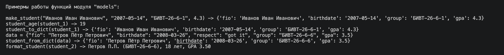
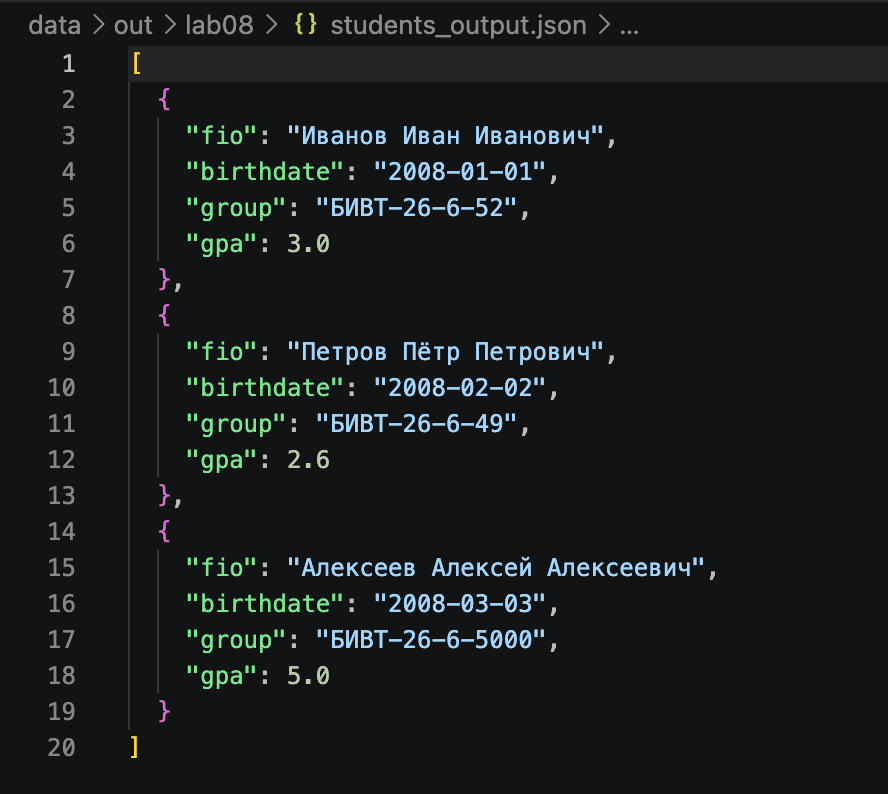
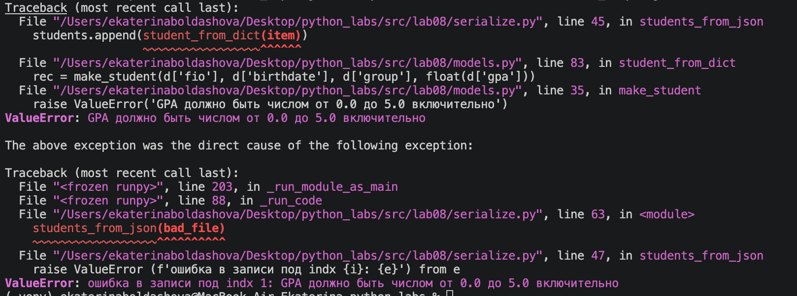

# Лабораторная работа №8
# Модель данных без классов: запись Student как словарь, валидация и сериализация

## Были реализованы два модуля с функциями, первый - для обработки и валидации записей, второй - для сериализации записей.

## 1ый модуль "models" (обработка и валидация):
- make_student - создание записи
```python
def make_student(fio, birthdate, group, gpa):
    '''
    Создание записи после проверки корректности данных,
    при некорректности - TypeError или ValueError.
    '''
    values = {"fio":fio,"birthdate":birthdate,"group":group, "gpa": gpa}
    for k in values:
        if k=="gpa":
            continue
        if not isinstance(values[k],str):
            raise TypeError(f'{k} должно быть строкой, получено {type(fio)}')
        if not values[k].strip():
            raise ValueError(f"{k} не должно быть пустым")
    if not isinstance(gpa,float):
        raise TypeError(f'GPA должно быть вещественным числом, получено {type(gpa)}')

    if len(fio.split())<2:
        raise ValueError('введено неполное ФИО')
    if len(fio.split())>3:
        raise ValueError('введено слишком много слов для ФИО')
    
    try:
        born = date.fromisoformat(birthdate)
    except ValueError:
        raise ValueError(f'birthdate: некорректная дата {birthdate}, требуется формат YYYY-MM-DD')
    if born > date.today():
        raise ValueError(f'{birthdate} дата из будущего')

    if float(gpa)>5.0 or float(gpa)<0.0:
        raise ValueError('GPA должно быть числом от 0.0 до 5.0 включительно')

    return values
```

- validate_student - валидация готовой записи в виде словаря
```python
def validate_student(rec):
    '''
    Валидация записи о студенте.
    '''
    if not isinstance(rec, dict):
        raise TypeError(f'ожидается словарь, получено {type(rec)}')
    expected = set(STUDENT_FIELDS)
    given = set(rec)
    if expected != given:
        missing = expected - given
        extra = given-expected
        raise ValueError(f'неверный набор ключей: не хватает {missing}, лишние {extra}')
    make_student(**rec)
```

- student_age - вычисление возраста студента из записи
```python
def student_age(rec, today=None):
    '''
    Вычисление возраста студента, по умолчанию, на сегодня.
    При желании посчитать на другой день - задать явно через параметр today.
    '''
    
    birthdate = rec['birthdate']
    if not today:
        today = date.today()
    else: 
        try:
            today = date.fromisoformat(today)   
        except ValueError:
            raise ValueError(f'today: некорректная дата {today}, требуется формат YYYY-MM-DD')
    try:
        born = date.fromisoformat(birthdate)   
    except ValueError:
        raise ValueError(f'birthdate: некорректная дата {birthdate}, требуется формат YYYY-MM-DD')
    if born > date.today():
        raise ValueError(f'{birthdate} дата из будущего')
    had_birthday = (today.month, today.day) >= (born.month, born.day)
    if had_birthday == True:
        return today.year - born.year
    return today.year - born.year - 1
```

- student_to_dict - создание копии записи
```python
def student_to_dict(rec: dict) -> dict:
    '''
    Создание копии студента при успешной валидации.
    '''
    validate_student(rec)
    return dict(rec)
```

- student_from_dict - десериалиазация из словаря
```python
def student_from_dict(d: dict) -> dict:
    '''
    Десериализация данных из словаря только по нужным параметрам.
    '''
    missing = [k for k in STUDENT_FIELDS if k not in d]
    if missing:
        raise ValueError(f'отсутствуют ключи: {missing}')
    rec = make_student(d['fio'], d['birthdate'], d['group'], float(d['gpa']))
    return rec
```

- format_student - красивый вывод записи
```python
def format_student(rec):
    '''Форматирует запись студента в читаемую строку с инициалами и возрастом.'''
    parts = rec['fio'].split()
    second_name = parts[0]
    initials = ''.join(p[0].upper() + '.' for p in parts[1:])
    group = rec['group']
    age = student_age(rec)
    gpa = f"{rec['gpa']:.2f}"
    return f"{second_name} {initials} ({group}), {age} лет, GPA {gpa}"
```


## 2ой модуль "serialize" (сериализация):
- students_to_json - сериализация списка записей в json-файл
```python
def students_to_json(students, path):
    '''
    Запись списка студентов в .json файл.
    '''
    data = [student_to_dict(s) for s in students]
    if Path(path).suffix.lower() != '.json':
        raise ValueError(f"Указанный файл не формата JSON: {path}")
    ensure_parent_dir(path)
    with open(path, 'w', encoding='utf-8') as f:
        json.dump(data, f, ensure_ascii=False, indent=2)

```

- students_from_json - сериализация json-файла в список записей
```python
def students_from_json(path: str):
    '''
    Преобразование .json файла в список студентов.
    Политика обработки битых записей: strict. Первая битая запись
    вызывает ValueError/TypeError с номером записи и причиной.
    '''
    j_p = Path(path)
    
    if not j_p.exists():
        raise FileNotFoundError(f"файл не найден: {j_p}")
    if j_p.suffix.lower() != '.json':
        raise ValueError(f"Указанный файл не формата JSON: {j_p}")
    

    with j_p.open('r', encoding='utf-8') as j_f:
        try:
            data = json.load(j_f)
        except json.JSONDecodeError as e:
            raise ValueError(f"Файл содержит некорректный JSON: {e.lineno}, {e.msg}")
        if not isinstance(data,list) or len(data) == 0:
            raise ValueError("Файл JSON пустой или имеет неправильный формат")
        if not all(isinstance(x, dict) for x in data):
            raise ValueError("Все элементы списка JSON должны быть словарями")
    
    students=[]
    for i,item in enumerate(data,1):
        try:
            students.append(student_from_dict(item))
        except ValueError as e:
            raise ValueError (f'ошибка в записи под indx {i}: {e}') from e
        except TypeError as e:
            raise TypeError (f'ошибка в записи под indx {i}: {e}') from e
    return students
```

### Примеры работы 
### 1. Функции из "models"


### 2. Функции из "serialize"
### 1. из students_from_json в students_to_json



### 3. Пример ошибки на функциях из модуля serialize 



